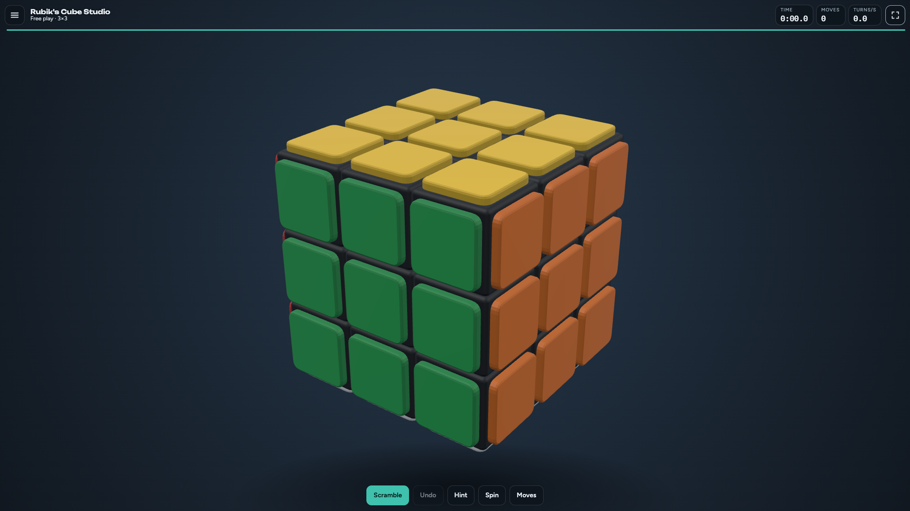
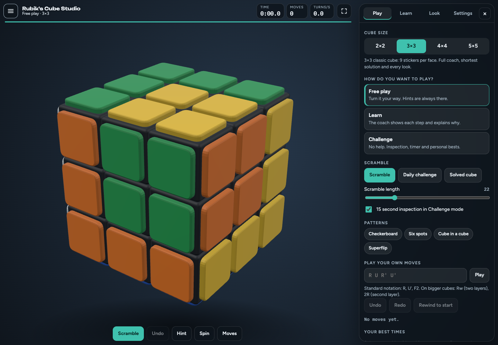
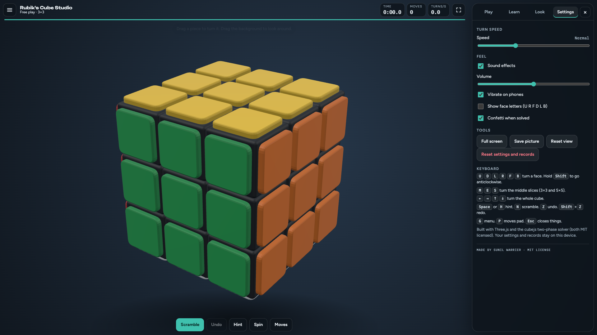

# Rubik's Cube Studio

A complete 3D Rubik's Cube that runs in any modern browser on desktop, phone and tablet. No install, no server.
**Open `index.html`.** It is one self-contained file (Three.js and the solver are inside it).

Made by Sunil Warrier. The app credit is in the Settings panel.

## Screenshots

The main screen was captured from [rstudio.uti1.com](https://rstudio.uti1.com/).
The Patterns view shows the built-in pattern choices in the Play menu. The
Settings view was captured from the updated local build and shows the new
credit.

## License

The original Rubik's Cube Studio source code and project documentation are
licensed under the [MIT License](LICENSE). You may use, modify, and redistribute
them, including in commercial projects, provided you retain the copyright and
license notice.

Third-party software keeps its own license terms. The bundled Three.js and
cubejs license notices are preserved in `vendor/`.

## Play
- **Touch or mouse:** drag a sticker and that row or column follows your finger, then settles on the nearest turn. Drag the background to look around. Pinch or scroll to zoom.
- **Keyboard:** `U D L R F B` turn faces (hold Shift for anticlockwise), `M E S` middle slices, arrow keys turn the whole cube, `Z` undo, `Shift+Z` redo, `N` scramble, `H` or Space hint, `P` moves pad, `G` menu, `Esc` closes things.
- **Menu inside the screen:** the button at top left opens it. Desktop: a panel on the right. Phone: a sheet that slides up. Four tabs: Play, Learn, Look, Settings. Nothing needs scrolling the page.

## Sizes
2x2, **3x3 (default, 9 stickers per face)**, 4x4 and 5x5.

## Learning
- **Coach (2x2 and 3x3):** works out which stage you are on from your actual cube, explains the next step, highlights the layer, draws a turn arrow and shows a moving hand that follows the real path of a swipe. It follows your own turns and re-plans if you go a different way.
- **Play this step, One move, Solve it for me:** watch it done at your chosen speed.
- **Shortest solution (2x2 and 3x3):** a computer search (Kociemba two-phase on 3x3) usually 18 to 22 moves.
- **Methods and algorithms:** Beginner, CFOP, Roux, ZZ, plus a list of algorithms you can play on your cube.
- **4x4 and 5x5:** play, scramble, undo, rewind and **Retrace to solved** (undoes every move back to solved). The step coach is for 2x2 and 3x3.

## Modes
Free play, Learn, and Challenge (no hints, optional 15 second inspection, timer, personal bests, daily challenge with the same scramble for everyone that day).

## Looks
7 colour themes (including colour-blind friendly), 7 picture themes (wild animals, ocean life, mythical creatures, Greek gods, space, fruit, gradient art), your own photo, three cube styles (flat, raised tiles, chunky blocks), four body colours, matte finish, 8 animated backgrounds plus your own photo, face letters, confetti, sound and vibration, and speeds from Slowest to Instant.
Picture themes are emoji on raised 3D tiles. Solving the cube puts each big picture back together.

## Files
- `index.html` the built app (open this)
- `src/` source: `puzzle.js` (cube model and notation), `scene.js` (Three.js view), `coach*.js`, `themes.js`, `fx.js`, `store.js`, `hand.js`, `app.js`, `style.css`, `index.template.html`
- `build.js` rebuilds `index.html`: `node build.js`
- `tests/` model and coach tests: `node tests/puzzle.test.js` and `node tests/coach.test.js`
- `vendor/` Three.js r158 and cubejs, both MIT licensed

Settings, the game in progress and records are saved in your browser only.
